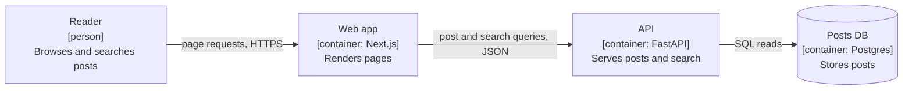

# Craft: the rules worth keeping, and the writers worth copying

This file condenses two books and a style guide (Zinsser, Google style, *Clarity*) into
rules you can apply while drafting, adds rules for diagrams, then describes the moves of
writers whose technical prose reads as human and smart. Use it when drafting from scratch or
when a revision needs more than deleting tells.

## Zinsser (On Writing Well), applied to technical writing

- **Clarity.** Know what you think before you write. If you can't say the point in two
  sentences, you're not ready to draft. Ask "what am I trying to say?" and then "have I said it?"
- **Simplicity.** Use the short word over the long one, the verb over the noun, the active
  voice over the passive.
- **Brevity.** Clutter is the disease. Cut every word that does no work: "currently", "in
  order to", "basically", "actually", "very", "a number of", "it is important to note that".
  Most first drafts can lose a third without losing a fact.
- **Humanity.** Write as a person to a person. Use "I" when you mean yourself. Your opinions
  and doubts are the part only you can supply.
- **Unity.** Pick one tense, one person, one register and one reader, and keep them.
- **The lead and the ending.** The first sentence has to pull the reader into the second. Stop
  when you've made the point. Don't summarize what the reader just read.

## Google developer documentation style, the parts that carry over to essays

- Second person ("you") for instructions. Present tense. Active voice.
- Sentence case for headings. Headings say what the section is about, not a teaser.
- Put the condition before the instruction: "To rebuild the index, run...", not "Run... to
  rebuild the index."
- Lists for steps and for parallel items that really are parallel. Prose for reasoning.
- Define a term the first time you use it. Spell out an acronym on first use.
- Code, commands, file names and values in code font. Show real, runnable examples.
- Global readers: no idioms that don't translate, no culture-bound jokes in instructions,
  short sentences where precision matters.
- No "simply", "just", "easy", "obviously". What's easy for you is the reader's blocker.
- Use numerals for numbers and include units. "3 retries", "200 ms".

When Google style and the voice profile conflict in an essay, voice wins. In reference docs
and how-to steps, Google style wins.

## *Clarity*: making the logic visible

These rules come from the book *Clarity*. They cover the joins between sentences and
between paragraphs, which a draft can get wrong while every sentence in it is fine.

- **Say how sentences relate.** Use a connector: "because", "so", "but", "although". Two
  sentences set side by side leave the reader to guess whether the second is a cause, a
  result or an exception, and different readers guess differently.
- **Chain the paragraphs.** Each paragraph follows from the one before and sets up the next.
  To test it, cover the rest of the page after a paragraph and try to predict the next one.
  If you can't, the reader can't either.
- **Give the strongest objection its own paragraph.** State it as well as someone who holds
  it would, then answer it. Tucked into a clause, an objection reads as dodged.
- **Name who did it.** "The migration was rolled back" hides the team that decided. Write
  "the platform team rolled back the migration". If you don't know who, mark a TODO and ask,
  because the passive only hides the gap.
- **When you revise, reorder as well as cut.** A draft often has the right sentences in the
  wrong order, with the conclusion in the last paragraph or the example ahead of its claim.
  Move them before you trim them.
- **Interview the author when TODOs would outnumber facts.** Ask for the missing names,
  numbers and events before drafting, because a draft built on placeholders guesses its
  structure in advance and the facts that arrive later rarely fit it.

The book's advice doesn't override the opening rule in `SKILL.md`: open with the claim or a
scene, never with a question.

## Diagrams

Good software needs some documentation for humans, and part of it is easier to draw than to
write.

- **When a diagram earns its place.** Draw one for structure, flow or sequence that prose
  could carry only with a paragraph of cross-references ("the worker reads the queue the API
  writes to, which..."). A diagram never repeats what the prose beside it already says.
- **C4 levels for software and architecture docs.** Start with a context diagram: the system,
  its users and the external systems it talks to. Add a container diagram for the units you
  deploy or run and how they talk to each other. Draw a component diagram only where a
  module's internals matter to the reader. For a protocol or a multi-step flow, use a
  sequence diagram.
- **Mermaid in Markdown by default.** GitHub renders it, and it diffs as text in review.
  Mermaid has `C4Context` and `C4Container` types, but its own docs call C4 experimental, and
  an open issue (mermaid-js/mermaid#7358, checked October 2026) shows GitHub rendering them
  with oversized padding, clipped boxes and crossed relations. So use `flowchart` with
  C4-style labels: name, [type], one-line responsibility. Use `sequenceDiagram` for
  sequences.
- **Rules for every diagram.** Label every box and every arrow, and make each arrow say what
  flows ("orders, JSON over HTTPS"). Keep it to about 12 nodes. One diagram answers one
  question, so split one that tries to answer two. Give each a one-line caption saying what it
  shows.
- **Keep it true.** Derive the diagram from the code or config, not from memory, and name the
  source files in the caption or in a `%%` comment. A diagram nobody can trace to the code
  goes stale without anyone noticing.

*Containers of a small blog: what runs and what each part sends to the next.*

## Writers to learn from (copy the moves, not the sentences)

- **Martin Fowler.** Starts from a concrete situation seen on real projects. Names the idea,
  defines it in one plain paragraph, then shows where it breaks. Uses "I" freely and admits
  uncertainty plainly ("I don't have a strong opinion here"). Credits colleagues by name.
  Short bliki entries: one idea, said once, then stop.
- **Julia Evans.** Curiosity shows on the page. "I didn't understand X, so I tried Y, and here's
  what happened." Real commands, real output, small surprising details. Never pretends to
  know more than the post shows.
- **Dan Luu.** Blunt claims backed by data and links. Comfortable saying a common belief is
  wrong. Little ornament.
- **Paul Graham.** Plain words, short sentences, one argument pursued to its end.
- **Simon Willison.** Writes up what was actually done, links everything, and says plainly when
  an LLM helped and how. The disclosures are matter-of-fact, never apologetic.
- **Joel Spolsky / Charity Majors.** Opinionated, funny where it fits, stories from the job,
  named villains (practices, not people).

The common thread: a specific person who did a specific thing and has a view about it. That
is the part a model can't fake and the part a reader is looking for.

## When the voice profile runs out

A voice profile, default or personal, can't cover every kind of piece. When a task needs
something it doesn't cover, such as a news story, a README, a talk abstract or a register it doesn't
describe, copy the writers below for that kind of piece. The profile's hard rules still apply
(no invented facts, sentence-case headings, and the rest). This list fills gaps in the
profile; it doesn't override it.

| Kind of piece | Writers to copy | The moves |
|---|---|---|
| News report | Reuters and AP wire style. For technical news analysis, Jonathan Corbet at LWN.net | The news goes in the first sentence. Every fact has a named source: "said" for people, "found" or "reported" for a study or document. No adjectives that judge. Short paragraphs. Only quote what someone said better than you could paraphrase it. Headlines are sentence case, a full sentence with a verb, and true without the story. For a study, say who made it, who paid for it, how big it was and what it can't show. With no one to quote, attribute to the document and don't invent a reaction. Numbers follow the publication's style (AP: "Oct. 1", "percent"), which wins over the Google numeral rule. |
| Column or opinion | Paul Ford; Charity Majors; John Gruber at his best | One argument, said in the first few paragraphs. A personal stake, said once. Concrete evidence, then a clear verdict. Dry humor allowed. |
| Essay or blog post | Martin Fowler, Paul Graham, Julia Evans, Dan Luu | See above. Open on a situation, follow one idea to its end, stop. |
| Reference article or explainer | Fowler's long-form articles; Julia Evans; Stripe's API docs | Define the term once and plainly. One worked example, then the general rule. State limits and failure cases. |
| README, how-to, tutorial | Google developer style; Daniele Procida's Diátaxis | Say what kind of document it is: a tutorial, a how-to, reference or an explanation. Don't mix them. Numbered steps start with a verb. Show expected output. |
| Release notes, changelog | Simon Willison's release notes; the Keep a Changelog format | What changed, who it affects, what to do. Link the issue. No "exciting". |

If you're unsure how one of these writers would handle something, ask what a careful expert
on the subject would write for a reader who is short of time. That is usually the answer.

## Moves that make prose read as human and intelligent

1. **Lead with the claim, or with a scene.** Not with context-setting ("In today's
   fast-moving world of...").
2. **One concrete example beats three abstract ones.** Name the tool, the version, the
   number, the error message, the date.
3. **Commit.** Say what you'd do and why. When it really is "it depends", say what it depends
   on and which way you lean.
4. **Show the reasoning, including the wrong turn.** "I assumed the cache was stale. It
   wasn't." Readers trust a writer who shows where they were wrong.
5. **Earn every abstraction.** Introduce a principle after the example that made you believe
   it, not before.
6. **Vary the rhythm because the content varies.** Long sentences to carry a chain of
   reasoning. Short ones to land a point. Not alternating by rule.
7. **Leave out what the reader already knows.** Experts notice padding first.
8. **End on the last useful thing.** An open question, a next step, a sharp consequence. Not
   a moral.
9. **Allow asides and small jokes** where a person would make them. Keep them dry and brief.
10. **Coin a name only when you'll use it again,** and only if the idea doesn't already have one.
